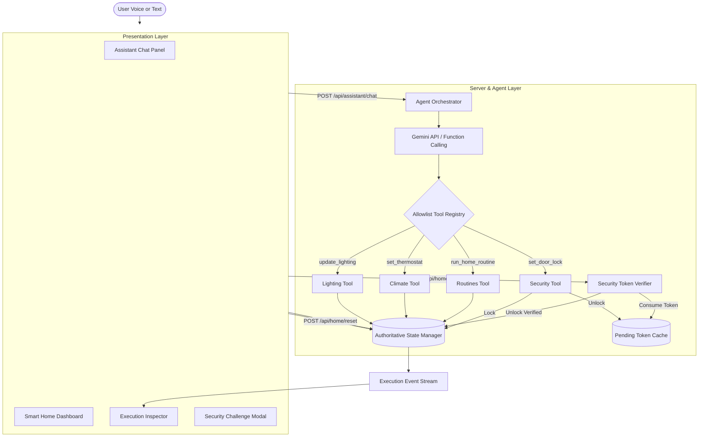

# AURA — Context-Aware Smart Home Agent

A simulated, Alexa+-style smart-home voice and text assistant powered by Gemini server-side function calling, authoritative state verification, multi-layer security challenge safeguards, and real-time execution event inspection.

> **Disclaimer**: AURA is an independent educational and research simulation created for hackathon demonstration. It is not affiliated with, sponsored by, or an official integration with Amazon Alexa or Alexa+. It interacts with simulated software devices only and does not control physical hardware.

---

## 📸 Screenshots

| Desktop 3-Column Experience | Security Confirmation Dialog | Execution Inspector |
|:---:|:---:|:---:|
| `[Screenshot Placeholder: Desktop 3-Column Interface (Chat, Devices, Inspector)]` | `[Screenshot Placeholder: Security Challenge Token Dialog for Door Unlock]` | `[Screenshot Placeholder: Real-time Event Stream with Expandable JSON Payloads]` |

---

## ✨ Features

- **Context-Aware Intent Interpretation**: Interprets compound, natural language instructions (e.g. *"Dim the living room light to 30%, set the temperature to 26 degrees, and lock the front door"*).
- **Official Gemini Function Calling**: Uses Google Gen AI SDK (`google-genai` / `@google/genai`) to map human utterances to strongly typed backend functions.
- **Authoritative Server-Side State**: Single source of truth. Device state cannot be modified directly by the frontend; every change is validated and executed server-side.
- **Physical Security Challenge Flow**: Sensitive physical perimeter actions (such as unlocking the front door) are halted until explicit human confirmation with a short-lived single-use cryptographic token (`sec_cf_...`).
- **Verifiable Execution Event Inspector**: Real-time audit stream detailing `user_request`, `intent_interpretation`, `tool_call`, `tool_result`, `state_verification`, and `assistant_response` with expandable JSON arguments and results.
- **Automated Home Routines**: Single-trigger routines (*Leaving Home*, *Relaxing Evening*, *Good Morning*, *Secure Home*) that orchestrate multiple simulated appliances.
- **Browser Voice Input**: Hands-free voice recognition using the Web Speech API with microphone permissions, live status, and cancellation.
- **Zero-Flicker Local Fallback**: When Gemini API keys are absent, AURA transitions to a deterministic local parser, ensuring all controls and tests remain functional.

---

## 🛠 Technology Stack

### Frontend:
- **Framework**: React 19, TypeScript
- **Build Tool**: Vite 8
- **Styling**: Tailwind CSS
- **Icons**: Lucide React
- **Voice**: Web Speech API (`SpeechRecognition` / `webkitSpeechRecognition`)
- **Networking**: Fetch API with custom error handling

### Backend:
- **Python Backend**: Python 3.10+, Flask, Flask-CORS, python-dotenv, pytest
- **AI SDK**: Google Gen AI SDK (`google-genai` Python SDK & `@google/genai` TypeScript SDK)
- **Node/Express Fullstack**: Express 4, Vite middleware integration, tsx

---

## 🏛 Architecture Diagram



---

## 📂 Project Structure

```text
.
├── .env.example                     # Root environment configuration template
├── .gitignore                       # Git exclusion rules
├── index.html                       # HTML application entry point
├── metadata.json                    # Project metadata & capabilities
├── package.json                     # Frontend & fullstack npm dependencies
├── tsconfig.json                    # TypeScript configuration
├── vite.config.ts                   # Vite configuration
├── server.ts                        # Fullstack Node/Express server with Vite middleware
│
├── backend/                         # Standalone Python Flask Backend
│   ├── app.py                       # Flask entry point & API route handlers
│   ├── config.py                    # Environment & runtime configuration
│   ├── requirements.txt             # Python dependencies
│   ├── .env.example                 # Backend environment variable template
│   ├── run_tests.py                 # Standalone test runner
│   │
│   ├── agent/                       # Agent orchestration package
│   │   ├── __init__.py
│   │   ├── gemini_agent.py          # Google Gen AI SDK client wrapper
│   │   ├── tool_definitions.py      # Declarations for Gemini Function Calling
│   │   └── orchestrator.py          # Tool execution loop & local fallback parser
│   │
│   ├── tools/                       # Validated smart-home tool handlers
│   │   ├── __init__.py
│   │   ├── lighting.py              # update_lighting implementation
│   │   ├── climate.py               # set_thermostat implementation
│   │   ├── security.py              # set_door_lock with challenge workflow
│   │   └── routines.py              # run_home_routine composite runner
│   │
│   ├── home/                        # Authoritative state management
│   │   ├── __init__.py
│   │   ├── state.py                 # In-memory authoritative state manager
│   │   └── validation.py            # Device parameter boundaries & schemas
│   │
│   └── tests/                       # Python test suite
│       ├── __init__.py
│       ├── conftest.py              # Pytest fixtures
│       ├── test_api.py              # Flask endpoint integration tests
│       ├── test_tools.py            # Unit tests for tools and validations
│       └── test_agent.py            # Orchestrator & compound command tests
│
├── src/                             # React Frontend Source
│   ├── main.tsx                     # React root mount
│   ├── App.tsx                      # Primary layout & state coordinator
│   ├── index.css                    # Tailwind CSS imports & theme styling
│   │
│   ├── types/
│   │   └── index.ts                 # TypeScript interfaces for states and events
│   │
│   ├── services/
│   │   └── api.ts                   # Fetch API service layer
│   │
│   ├── hooks/
│   │   └── useSpeechRecognition.ts  # Web Speech API hook
│   │
│   └── components/
│       ├── AppHeader.tsx            # Header, branding & demo reset button
│       ├── AssistantPanel.tsx       # Chat stream & voice composer
│       ├── ChatMessage.tsx          # Message bubbles & security action cards
│       ├── ChatInput.tsx            # Input composer with mic button & suggestions
│       ├── HomeDashboard.tsx        # Device grid & status summary
│       ├── DeviceCard.tsx           # Power toggle & brightness slider
│       ├── ClimateCard.tsx          # Thermostat dial & mode buttons
│       ├── SecurityCard.tsx         # Door lock status & unlock challenge trigger
│       ├── RoutineSelector.tsx      # Quick routines cards
│       ├── ExecutionInspector.tsx   # Real-time event inspector & filters
│       ├── EventItem.tsx            # Expandable event card with JSON payloads
│       ├── ConfirmActionDialog.tsx  # Security token confirmation modal
│       └── Toast.tsx                # Action toast notifications
│
└── docs/
    ├── ARCHITECTURE.md              # Detailed system architecture specification
    └── DEMO_SCRIPT.md               # 3-minute video presentation script
```

---

## 🚀 Getting Started

### Prerequisites

- **Node.js**: v18.0.0 or later
- **Python**: v3.10 or later (for standalone Python backend)
- **Gemini API Key**: Obtain a key from [Google AI Studio](https://aistudio.google.com/)

---

### Startup Option A: Integrated AI Studio / Fullstack Mode (Single Command)

In this environment or locally:
```bash
# 1. Install npm dependencies
npm install

# 2. Start fullstack server (Express + Vite on port 3000)
npm run dev
```
Open [http://localhost:3000](http://localhost:3000) in your browser.

---

### Startup Option B: Two-Terminal Setup (Flask + Vite)

#### Terminal 1 — Python Flask Backend

**macOS / Linux**:
```bash
cd backend
python3 -m venv venv
source venv/bin/activate
pip install -r requirements.txt
cp .env.example .env
# Edit .env and set your GEMINI_API_KEY
python app.py
```

**Windows Command Prompt (`cmd.exe`)**:
```cmd
cd backend
python -m venv venv
venv\Scripts\activate.bat
pip install -r requirements.txt
copy .env.example .env
REM Edit .env to add your GEMINI_API_KEY
python app.py
```

**Windows PowerShell**:
```powershell
cd backend
python -m venv venv
.\venv\Scripts\Activate.ps1
pip install -r requirements.txt
Copy-Item .env.example .env
# Edit .env to add your GEMINI_API_KEY
python app.py
```
The Flask backend will run on `http://localhost:5000`.

---

#### Terminal 2 — React Vite Frontend

**macOS / Linux / Windows**:
```bash
npm install
npm run dev
```
By default, the Vite dev server will connect to the backend via `VITE_API_BASE_URL`.

---

## 🔑 Environment Variables

| Variable | Description | Default |
|---|---|---|
| `GEMINI_API_KEY` | Google AI Studio Gemini API Key | `""` (runs in local fallback mode if omitted) |
| `GEMINI_MODEL` | Gemini model alias or identifier | `gemini-3.8-flash` |
| `VITE_API_BASE_URL` | Base URL for REST endpoints | `/api` |
| `FRONTEND_ORIGIN` | Allowed CORS origin in Flask | `http://localhost:5173` |
| `PORT` | Server listening port | `3000` (Node) / `5000` (Flask) |

---

## 📡 API Endpoint Reference

### `GET /api/health`
- **Description**: Returns service health status and model configuration.
- **Response**:
  ```json
  {
    "status": "healthy",
    "service": "AURA Context-Aware Smart Home Agent",
    "gemini_configured": true,
    "model": "gemini-3.8-flash",
    "mode": "gemini",
    "simulation": true
  }
  ```

### `GET /api/home`
- **Description**: Returns the complete current state of simulated devices.

### `POST /api/assistant/chat`
- **Description**: Ingests natural language commands, dispatches tools, and updates state.
- **Request Body**:
  ```json
  {
    "message": "Dim living room light to 30% and set thermostat to 24 degrees",
    "request_id": "req_12345"
  }
  ```
- **Response**:
  ```json
  {
    "response": "Living room light dimmed to 30% and thermostat set to 24°C.",
    "home_state": { "devices": { ... }, "last_updated": "..." },
    "events": [ ... ],
    "confirmation_required": false,
    "mode": "gemini"
  }
  ```

### `POST /api/home/confirm`
- **Description**: Verifies and executes a pending security challenge.
- **Request Body**:
  ```json
  { "token": "sec_cf_0123456789abcdef" }
  ```

### `POST /api/home/reset`
- **Description**: Restores devices to initial demo settings.

---

## 🧪 Testing

### Running the Python Test Suite
```bash
# Standalone test runner (no extra test runner packages required)
python3 backend/run_tests.py

# Or with pytest inside virtual environment
cd backend
pytest -v
```

All 27 test cases test:
- Unit tools (lighting boundaries, brightness=0 turning light off, temperature constraints $[16, 30]^\circ\text{C}$).
- Security token creation, single-use consumption, and rejection of reused or expired tokens.
- Routines (*Leaving Home*, *Relaxing Evening*, etc.).
- Compound command orchestration.
- Rejection of unauthorized tools.
- API endpoints with zero secret leakage.

---

## 🛡 Security Practices

1. **No Client-Side Secrets**: `GEMINI_API_KEY` is loaded strictly server-side and never returned in API payloads or client code.
2. **Strict Tool Allowlisting**: Only registered tool functions (`get_home_status`, `update_lighting`, `set_thermostat`, `set_door_lock`, `run_home_routine`) can be dispatched.
3. **Single-Use Challenge Tokens**: Unlocking doors requires cryptographic tokens with 60-second expiration. Tokens are consumed immediately upon verification.
4. **Authoritative State Enforcement**: Client UI elements cannot mutate device records without calling validated backend endpoints.

---

## 📝 License

This project is licensed under the Apache-2.0 License.
