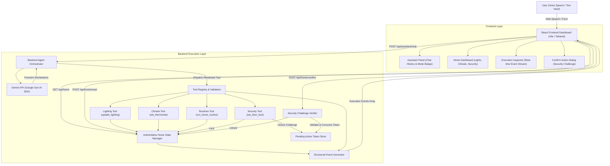
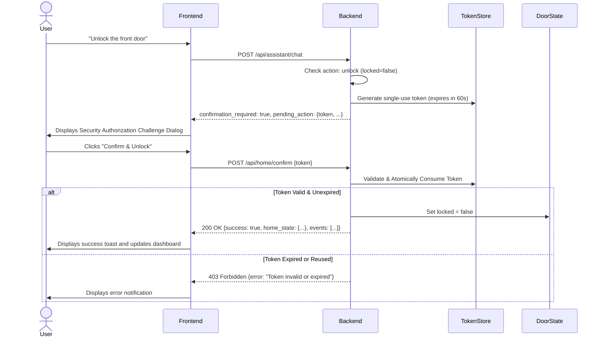

# AURA System Architecture & Design Specification

AURA is an Alexa+-style simulated smart-home agent architecture that combines large language model natural-language understanding with a strictly authoritative, deterministic backend execution layer, strict parameter validation, explicit security authorization challenges, and verifiable execution event logging.

---

## 1. System Overview & Boundaries



---

## 2. Frontend / Backend Separation of Concerns

1. **Client Layer (React / TypeScript)**:
   - Responsible strictly for rendering the user interface, capturing text or browser speech recognition (`useSpeechRecognition`), and displaying backend-generated execution events.
   - **Zero Direct State Mutation**: The frontend *never* modifies device states directly. When a user clicks a toggle button or adjusts a slider, an API request is dispatched to the backend, which executes validated tool logic and returns the updated authoritative state.
   - **Zero Telemetry Fabrication**: The Execution Inspector only displays real events emitted by the backend orchestrator and tools.

2. **Backend Execution Layer (Python Flask & Node.js Express)**:
   - Holds the single authoritative source of truth (`HomeStateManager`).
   - Enforces parameter boundaries (e.g. brightness $0 \dots 100$, temperature $16.0 \dots 30.0^\circ\text{C}$).
   - Generates unpredictable, single-use, short-lived security tokens for sensitive actions.
   - Orchestrates multi-turn tool calling with Gemini.

---

## 3. Gemini Function-Calling Loop

When a user submits a natural-language request (e.g., *"Dim the living room light to 30%, set the temperature to 26 degrees, and lock the front door"*):

1. **User Request Event**: The backend generates an initial event:
   ```json
   {
     "id": "evt_...",
     "type": "user_request",
     "message": "Received user request: \"...\""
   }
   ```
2. **Intent Interpretation**: If Gemini is configured, the request is passed to Gemini alongside tool definitions (`get_home_status`, `update_lighting`, `set_thermostat`, `set_door_lock`, `run_home_routine`).
3. **Structured Tool Calls**: Gemini inspects the tools and issues function calls (e.g., three separate calls for compound instructions).
4. **Tool Execution & Allowlist Validation**: The orchestrator checks each call against registered handlers. Unknown or arbitrary tool names are strictly rejected.
5. **Tool Result Feedback**: The tool handler executes, applies changes to `HomeStateManager`, and returns a structured object `{ success, tool, arguments, result, error }`.
6. **State Verification**: For every successful mutation, a `state_verification` event is emitted containing the updated device state.
7. **Synthesis Turn**: Function responses are provided back to Gemini as role `user` messages, prompting Gemini to produce the final, truthful human-readable response.
8. **Loop Bound**: The loop is capped at a maximum of 5 rounds to prevent runaway invocations.

---

## 4. Security Confirmation Workflow

Unlocking the simulated front door is classified as a sensitive physical security perimeter operation.



### Safety Invariants:
- The `/api/home/confirm` endpoint **never** accepts arbitrary commands or instructions from the client.
- The action to be executed is bound strictly on the server at token creation time (`action: "unlock_door"`).
- Reusing a token immediately fails because the token is deleted from memory upon first validation attempt.

---

## 5. Structured Execution Event Schema

Every step of execution produces an immutable event:

| Field | Type | Description |
|---|---|---|
| `id` | `string` | Unique dynamic event identifier (`evt_<uuid>`) |
| `timestamp` | `string` | ISO-8601 UTC timestamp |
| `type` | `EventType` | Event lifecycle category |
| `message` | `string` | Human-readable explanation of the action taken |
| `tool` | `string \| null` | Name of the tool invoked (if applicable) |
| `arguments` | `object \| null` | Sanitized inputs passed into the tool |
| `success` | `boolean` | Whether the step succeeded |
| `result` | `any \| null` | Verified output or error details |

### Supported Event Types:
- `user_request`: Request ingestion
- `intent_interpretation`: Model prompt / fallback classification
- `tool_call`: Parameter validation and tool dispatch
- `tool_result`: Output from tool execution
- `state_verification`: Authoritative snapshot verification after change
- `confirmation_required`: Security challenge issued
- `clarification_required`: Ambiguous instruction detected
- `assistant_response`: Final natural language output
- `error`: Handled failure or rejection

---

## 6. Deterministic Local Fallback Mode

If `GEMINI_API_KEY` is not provided, is invalid, or the network encounters an error:
- AURA enters **Local Fallback Mode**.
- The UI displays a clear indicator informing the user that deterministic local command parsing is active.
- Common commands (lighting toggle/dimming, thermostat temperature/mode adjustments, routines, door lock/unlock) are parsed deterministically.
- Full execution events and security confirmation challenges remain 100% operational.
